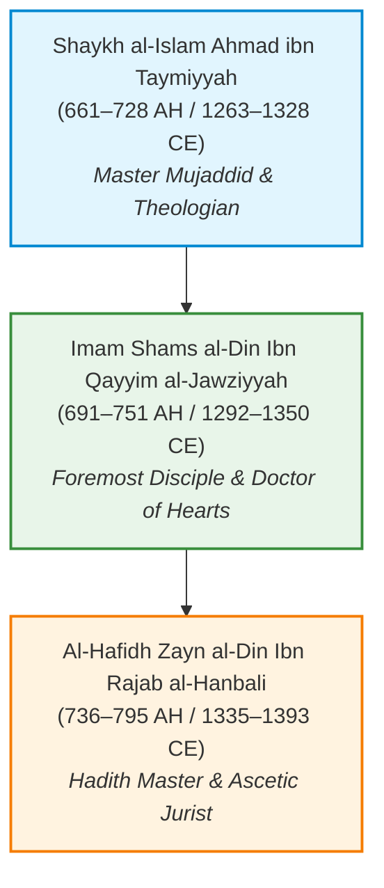

# Library: The Golden Chain (مكتبة السلسلة الذهبية)
### *A Dedicated Digital Turath Collection of Shaykh al-Islam Ibn Taymiyyah, Imam Ibn Qayyim al-Jawziyyah, and Al-Hafidh Ibn Rajab al-Hanbali*

---

## 🌟 About This Library
The **Golden Chain (السلسلة الذهبية)** represents one of the most intellectually rigorous and spiritually profound teacher-student lineages in the history of Islamic thought:

This sister library to [Islamic Classical Library](../islamic_classical_library/README.md) assembles **the entire OpenITI classical Arabic corpus** alongside **prominent English translations** for all three luminaries.

---

## 📂 Library Architecture & Summary

| # | Scholar Section | Arabic Works | English Works | Total | Key Highlights |
|---|---|:---:|:---:|:---:|---|
| **01** | [**Shaykh al-Islam Ibn Taymiyyah**](01_Shaykh_al_Islam_Ibn_Taymiyyah/README.md) | 124 | 6 | 130 | *Al-Wasitiyyah*, *Al-Ubudiyyah*, *Al-Furqan*, *Amrad al-Qulub*, *Usul al-Tafsir*, *Dar' Ta'arud*, *Minhaj al-Sunnah* |
| **02** | [**Imam Ibn Qayyim al-Jawziyyah**](02_Imam_Ibn_Qayyim_al_Jawziyyah/README.md) | 44 | 3 | 47 | *Zad al-Ma'ad*, *I'lam al-Muwaqqi'in*, *Al-Fawa'id*, *Al-Da' wal-Dawa'*, *Madarij al-Salikin*, *Kitab al-Ruh* |
| **03** | [**Al-Hafidh Ibn Rajab al-Hanbali**](03_Al_Hafidh_Ibn_Rajab_al_Hanbali/README.md) | 29 | 5 | 34 | *Jami' al-'Ulum wal-Hikam*, *Lata'if al-Ma'arif*, *Fadl 'Ilm al-Salaf*, *Al-Farq bayna al-Nasiha*, *Ahwal al-Qubur* |
| | **GRAND TOTAL** | **197** | **14** | **211** | **Full Classical Heritage** |

---

## 🔗 Bidirectional Links & Related Repositories
- 🏛️ **[Islamic Classical Library](../islamic_classical_library/README.md)**: Main digital library containing Quran, Hadith, Tafsir, Hadith Commentaries (Shuruhaat), Turath Texts, and Matn al-Usool.
- 📋 **[Complete Machine Catalog](CATALOG.json)**: JSON schema catalog of all 211 works with titles, paths, and byte sizes.
- 🧪 **[Verification Report](VERIFICATION_REPORT.md)**: Automated validation report confirming zero corrupted files, valid UTF-8, and complete frontmatter.
- 📁 **Symlink**: Accessible via both `library-the-golden-chain` and `libray-the-golden-chain`.

---

## 🛠️ Curation & Verification Pipeline
This dedicated library was curated and validated through an automated processing pipeline:
- **Corpus Ingestion**: Extraction of OpenITI critical editions with volume and page anchors preserved.
- **Metadata Enrichment**: Standardized YAML frontmatter specifying author, death year, editor, volume count, and classical lineage.
- **Verification Audit**: 221-point automated test suite ensuring 100% UTF-8 validity, non-empty text, and complete structural conformity.

---

## 📜 Licenses & Attribution
- **Arabic Turath Corpora**: OpenITI (Open Islamic Texts Initiative) - CC-BY-SA 4.0 / Public Domain.
- **English Translations**: Preserved for non-profit open scholarly and educational research under fair use / public domain.
